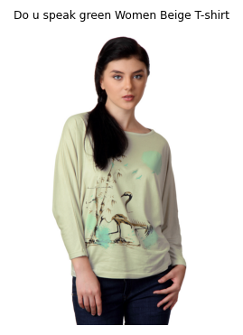
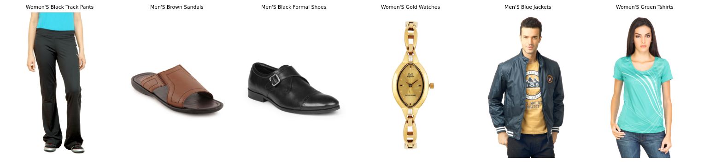
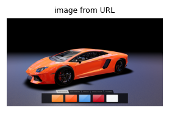

# Fashion VQA — ask questions about product images

A vision-language model (**Qwen2-VL-2B + LoRA**) fine-tuned to look at a fashion product photo and answer in **catalog language**:

- color
- article type
- category
- target gender
- usage
- season
- yes/no checks
- a one-line product description

**90% exact-match** on held-out products, versus 52% for the same model zero-shot.

[](https://www.kaggle.com/models/iesusdavila/fashion-vlm)


> How the model was trained and evaluated → [`training/README.md`](training/README.md)

---

## Demo

Everything below comes from [`fashion_vlm_inference.ipynb`](fashion_vlm_inference.ipynb), run on one T4 with ~4.2 GB of VRAM.

### 1. Product sheet from one image



`product_sheet(image)` asks the 7 attribute questions plus "Describe this product." in a single batched call. The image is a validation product the model never saw during training.

| | prediction | catalog label |
|---|---|---|
| baseColour | green | beige |
| articleType | tops | tshirts |
| subCategory | topwear | topwear |
| masterCategory | apparel | apparel |
| gender | women | women |
| usage | casual | casual |
| season | summer | summer |

```json
"description": "A green women's tops from the topwear category (apparel), for casual use, fall season."
```

The two misses are borderline cases. The product is called *"Do u speak **green**"* and is a pale sage tone that the catalog labels *beige*. A loose long-sleeve top sits between *tops* and *tshirts*.

<br clear="right">

### 2. Free questions

```python
ask(img, "Is this item black?")                                  # 'no'
ask(img, "Is this item for men, women, boys, girls or unisex?")  # 'women'
ask(img, "What kind of article is this?")                        # 'tops'
```

### 3. Confidence with top-k

`top_k(image, question, k)` runs beam search and returns the *k* most likely answers with their probabilities. The probabilities show *how sure* the model is, not just what it answers:

```text
What color is this product?        What type of product is this?      Which season is this product for?
   66.0%  green                       89.3%  tops                        48.7%  summer
   22.3%  grey                        10.3%  tshirts                     48.6%  fall
    3.4%  cream                        0.1%  shirts                       1.5%  spring
    1.7%  white                        0.0%  shirt                        0.9%  winter
    1.1%  yellow                       0.0%  sweaters
```

Season is a coin flip between summer and fall. The model knows it cannot tell the season from the picture, and the greedy description even picks *fall* while the direct question picks *summer*. This is the signal to use when deciding which tags need human review.

### 4. Zero-shot vs fine-tuned

`compare(image, questions)` runs the same weights with the LoRA adapter off and on:

| question | zero-shot | fine-tuned |
|---|---|---|
| What color is this product? | green | green |
| What type of product is this? | shirt | **tops** |
| Who is this product for? | woman | **women** |
| Describe this product. | shirt | **A green women's tops from the topwear category (apparel), for casual use, …** |

The base model already sees the image. What fine-tuning adds is **answering in the catalog's vocabulary and format**, so the output can go straight into a database.

### 5. Listing audit

`audit_listing(image, claimed)` checks a seller's listing against the photo. For each attribute it compares the predicted value and adds a yes/no confirmation for color and type. Here the listing claims the item is *black*:

| attribute | claimed | predicted | yes/no check | verdict |
|---|---|---|---|---|
| baseColour | black | green | no | **REVIEW** |
| articleType | tshirts | tops | yes | OK |
| gender | women | women | | OK |
| usage | casual | casual | | OK |

The wrong color is flagged. The *tshirts* vs *tops* disagreement is cleared by the yes/no check, because the model accepts that it is also a t-shirt.

### 6. Batch auto-tagging

`tag_images(paths)` tags a folder of images in batches. On 48 catalog images, compared against `styles.csv`:

| masterCategory | usage | gender | subCategory | articleType | baseColour | season |
|---:|---:|---:|---:|---:|---:|---:|
| 100% | 97.9% | 95.8% | 93.8% | 77.1% | 70.8% | 60.4% |

<p align="center"></p>

### 7. Outside the catalog: an image from a URL



What happens with something that is not a fashion product?

| attribute | prediction |
|---|---|
| baseColour | orange |
| articleType | car |
| masterCategory | apparel |
| gender | men |
| usage | sports |

```python
top_k(url, "What color is this product?")            # orange 96.2% · red 3.3% · yellow 0.2%
top_k(url, "cual es la pintura de este producto?")   # orange 92.3% · red 5.8% · yellow 0.7%
top_k(url, "esto es un camion?")                     # no 99.8%
top_k(url, "is it a ball?")                          # no 99.99%
top_k(url, "is it a lamborghini?")                   # yes 99.7%
```

The base model's general knowledge survives fine-tuning. It recognizes the car and the brand, and it still understands questions in Spanish. But closed attributes get **forced into the fashion taxonomy** (`masterCategory: apparel`, `gender: men`), so the model should only be trusted on catalog-style packshots.

<br clear="right">

---

## Quickstart

```bash
pip install -U "transformers>=4.49,<5" "accelerate>=1.0" "peft>=0.13"
```

```python
import torch
from PIL import Image
from transformers import AutoProcessor, AutoModelForImageTextToText
from peft import PeftModel

BASE = "Qwen/Qwen2-VL-2B-Instruct"
ADAPTER = "/kaggle/input/models/iesusdavila/fashion-vlm/pytorch/default/1/adapter_best"
SYSTEM_PROMPT = ("You are a fashion catalog assistant. Look carefully at the product image and "
                 "answer the question with a short, exact answer using the catalog vocabulary.")

processor = AutoProcessor.from_pretrained(ADAPTER, min_pixels=32 * 28 * 28, max_pixels=196 * 28 * 28)
processor.tokenizer.padding_side = "left"
base = AutoModelForImageTextToText.from_pretrained(BASE, dtype=torch.float16, attn_implementation="sdpa").to("cuda")
model = PeftModel.from_pretrained(base, ADAPTER).eval()

@torch.no_grad()
def ask(image, question, max_new_tokens=16):
    msgs = [{"role": "system", "content": [{"type": "text", "text": SYSTEM_PROMPT}]},
            {"role": "user", "content": [{"type": "image"}, {"type": "text", "text": question}]}]
    text = processor.apply_chat_template(msgs, tokenize=False, add_generation_prompt=True)
    enc = processor(text=[text], images=[image.convert("RGB")], return_tensors="pt").to("cuda")
    with torch.autocast("cuda", dtype=torch.float16):
        out = model.generate(**enc, max_new_tokens=max_new_tokens, do_sample=False,
                             pad_token_id=processor.tokenizer.pad_token_id)
    return processor.batch_decode(out[:, enc["input_ids"].shape[1]:], skip_special_tokens=True)[0].strip()

ask(Image.open("product.jpg"), "What color is this product?")
```

To get the results above, keep the same system prompt and pixel budget, use greedy decoding and left padding, and set `max_new_tokens≈60` for descriptions. The full toolkit (`product_sheet`, `top_k`, `audit_listing`, `compare`, `tag_images`) is in the inference notebook.

## Acknowledgements

[Qwen2-VL](https://huggingface.co/Qwen/Qwen2-VL-2B-Instruct) (Qwen team) · [Fashion Product Images Dataset](https://www.kaggle.com/datasets/paramaggarwal/fashion-product-images-dataset) (Param Aggarwal) · Hugging Face `transformers`, `peft`, `accelerate`
